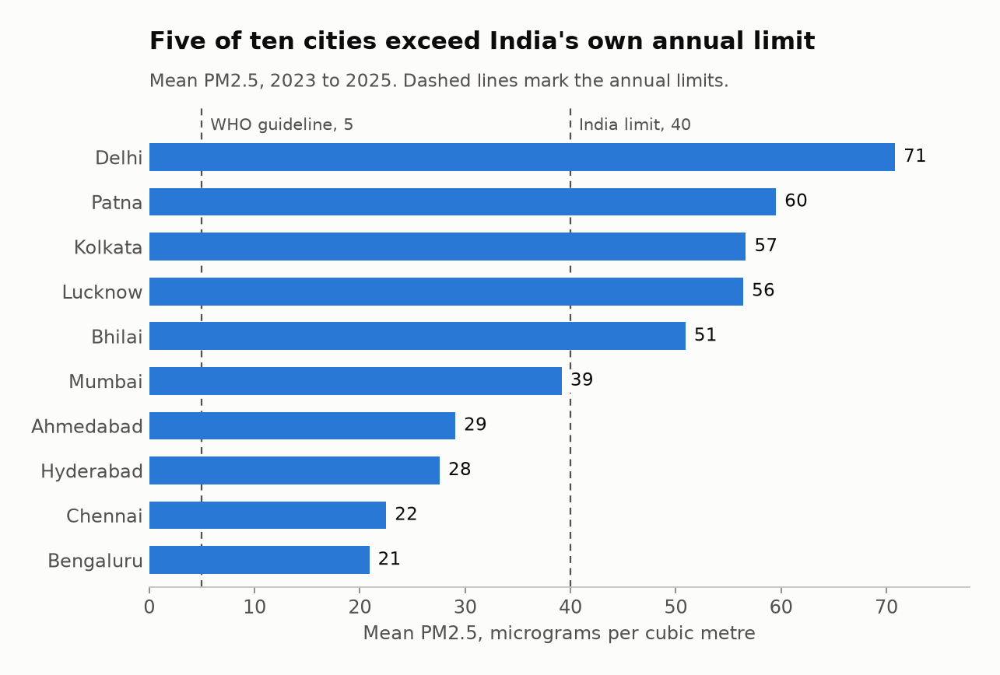
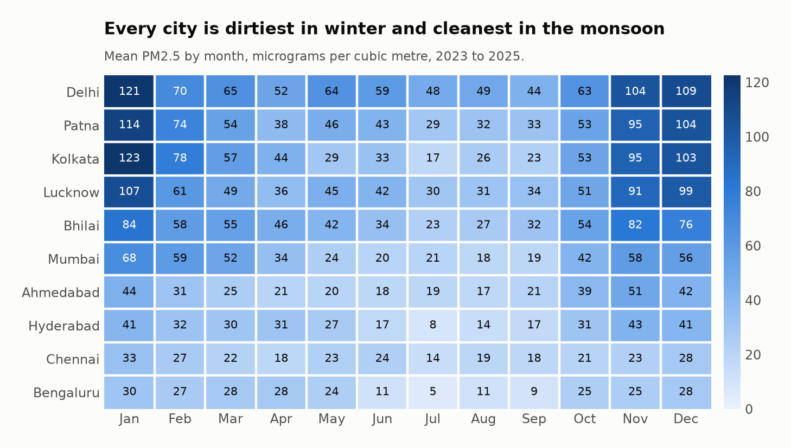
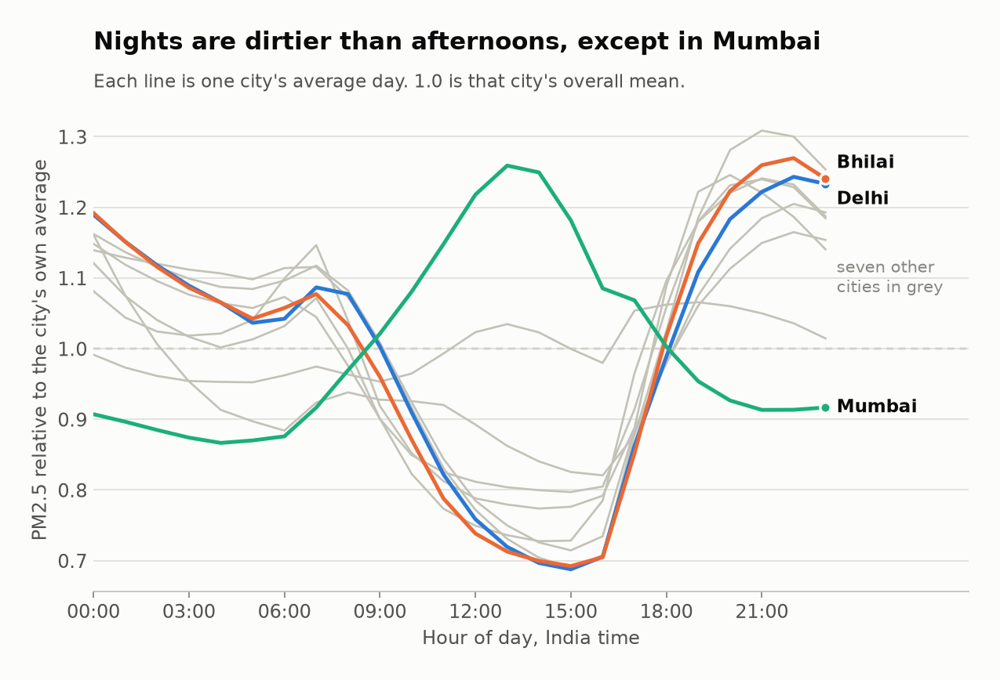
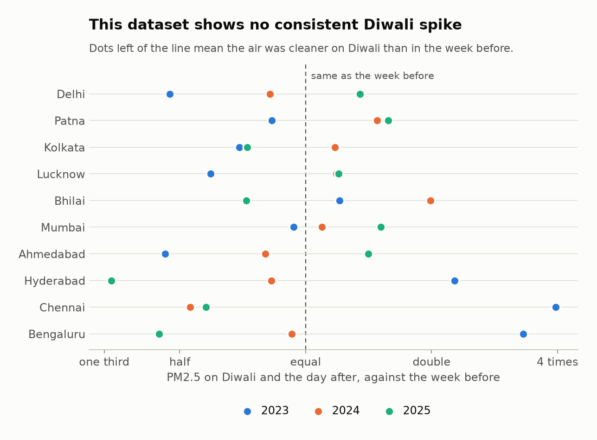

# Hawa

Three years of hourly PM2.5 across ten Indian cities, analysed with pandas. "Hawa" is Hindi for air.

I live in Bhilai, a steel town that rarely appears in air-quality coverage, and wanted to know how it compares with the cities that do. The dataset covers 2023 to 2025: 263,040 hourly readings, 10,960 city-days.

The full walkthrough, with every table, is in [`analysis.ipynb`](analysis.ipynb).

## Findings

### 1. Five of ten cities exceed India's own annual limit



India's annual limit is 40 µg/m³; the WHO guideline is 5. All ten cities are more than four times over the WHO figure, including Bengaluru, the cleanest. Delhi is above the Indian *daily* limit on 51% of days.

Bhilai ranks fifth at 51 µg/m³, closer to Lucknow than to Mumbai, and is over the daily limit on 31% of days.

### 2. Every city is dirtiest in winter



Winter (November to January) air carries between 1.5 and 4.2 times the PM2.5 of monsoon air. Kolkata has the widest swing, Chennai the narrowest. Patna and Kolkata each went about two months without a single day under the limit; Bhilai's longest unbroken spell was 32 days.

An annual average hides this: most of the exposure is packed into three months.

### 3. Nights are dirtier than afternoons



Eight cities are cleanest in mid-afternoon and dirtiest between 20:00 and 22:00. Daytime heating deepens the mixing layer and dilutes pollution; after sunset it collapses and traps emissions near the ground.

Chennai is nearly flat and Mumbai is inverted, peaking at 13:00. I cannot explain Mumbai from this dataset. It may be a sea-breeze effect, or an artefact of a model grid cell that is half ocean.

### 4. A result that did not appear: Diwali



I expected a clear Diwali spike. The data shows none: air was dirtier on Diwali than in the week before in only 14 of 30 city-years, and the median ratio is 0.93.

The cause is the data source. The numbers come from an atmospheric model driven by emission inventories and weather. Fireworks are a short local burst that is not in those inventories, so the model cannot see them. This dataset cannot answer the Diwali question; hourly ground-monitor data could.

## Data and its limits

The data comes from the [Open-Meteo Air Quality API](https://open-meteo.com/en/docs/air-quality-api), which serves the CAMS global atmospheric composition model.

- **It is modelled, not measured.** Values are estimates on a grid of roughly 40 km, not readings from monitors. They describe regional background air well and a busy junction poorly.
- **One point per city.** Each city is a single coordinate, so differences inside a city are invisible.
- **Three years is short.** Delhi's mean rose 21% and Mumbai's fell 22% between 2023 and 2025. One unusual winter can do that, so I do not call either a trend.

The natural next step is to repeat the analysis with CPCB ground-monitor data and see which findings survive.

## Method

- **Hours to days.** Limits are defined on 24-hour means, so hourly values are averaged per city per day. Days with fewer than 18 readings are dropped.
- **Comparing daily shapes.** Each city's hourly profile is divided by its own mean, so a clean city and a dirty city can share one chart.
- **Streaks.** The longest run of consecutive days over the limit; a missing day breaks a run.
- **Diwali.** Mean of Diwali day and the day after, divided by the mean of the seven days ending two days earlier.

Every transform is a small function in [`src/hawa/analysis.py`](src/hawa/analysis.py) that takes a DataFrame and returns one, and each is tested on hand-made rows in [`tests/`](tests/test_analysis.py).

## Run it

Requires [uv](https://docs.astral.sh/uv/).

```bash
uv sync
uv run pytest                  # 8 tests
uv run python -m hawa.fetch    # optional: re-download the data
uv run python -m hawa.charts   # regenerate the charts
```

The downloaded data is committed as `data/pm_hourly.csv.gz`, so the analysis runs without network access.

## Layout

```
src/hawa/fetch.py      download from the API
src/hawa/analysis.py   pandas transforms
src/hawa/charts.py     matplotlib figures
tests/                 unit tests for the transforms
analysis.ipynb         the walkthrough, with outputs
data/                  the hourly dataset (gzip CSV)
charts/                rendered figures
```

## Licence

Code: MIT. Data: Open-Meteo, CC BY 4.0, derived from CAMS (Copernicus Atmosphere Monitoring Service).
